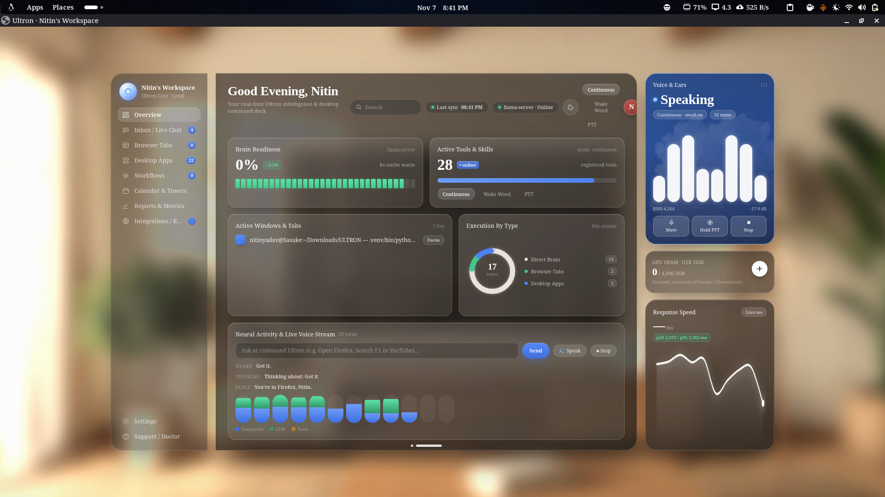
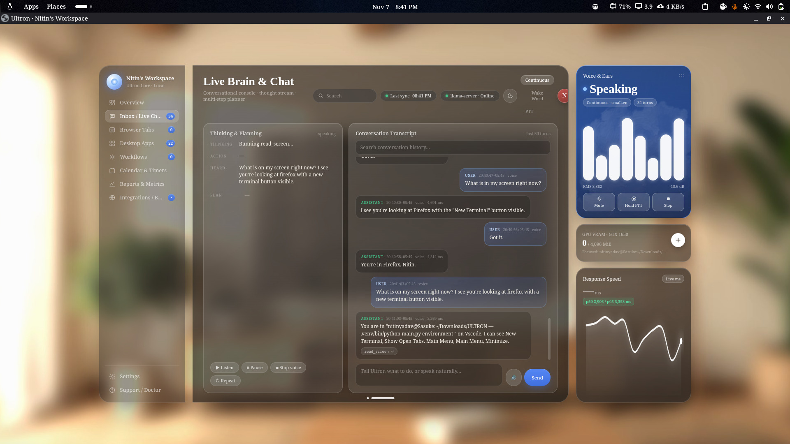

# ULTRON — Local Screen-Aware Voice AI Assistant & Spatial Glass Environment

-f59e0b?style=for-the-badge)

-10b981?style=for-the-badge)
-8b5cf6?style=for-the-badge)


> ### 🚧 Project Status: Ongoing Research & Development (Currently On Hold)
> **Ultron is an active, ongoing systems-engineering project and is NOT yet a finished consumer release.**  
> Development is currently paused at **Phase 10 (Standalone Spatial Glass Environment + Fedora 45 Wayland Engine)**. The foundational local voice pipeline, local GPU LLM server integration, Wayland desktop/app control, browser bridge scaffolding, and the Apple visionOS-inspired **Glassy Dashboard V18** are built and covered by **655 automated tests**. Active work on deeper real-time screen comprehension, the SQLite long-term memory engine, and full conversational stability will resume in upcoming phases.

---

## 📸 Screenshots — Glassy Dashboard V18 (Apple visionOS Spatial UI)

### Executive Command Deck (`Overview`)



### Live Brain, Thought Stream & Conversational Console (`Live Brain & Chat`)



---

## ⚡ Overview

**Ultron** is a **100% local, privacy-first, voice-controlled desktop AI assistant and standalone operating environment** built for Linux (Fedora Workstation / GNOME Wayland) on consumer hardware (tested on an NVIDIA GTX 1650 with 4 GB VRAM and 16 GB RAM).

Unlike cloud-dependent voice wrappers that send your microphone audio and screen captures to external APIs, every single stage of Ultron runs locally on your machine:

* **Ears (Speech-to-Text):** `faster-whisper` (`small.en` / `base.en`, CPU `int8`) with Silero VAD, rolling 3-second 10th-percentile noise-floor adaptation, adaptive stream warm-up, and screen-aware hotword priming.
* **Brain (Local LLM):** `LFM3-1.7B-Q6_K.gguf` served via `llama.cpp`'s `llama-server` with GPU offload (`-ngl 99`), a pinned slot-0 request (`id_slot: 0`, `cache_prompt: true`), and a sub-15 ms deterministic intent router for instant desktop actions.
* **Eyes (Screen & Browser Awareness):** 3-layer screen sensing combining GNOME Shell Wayland D-Bus Introspection (`org.gnome.Shell.Introspect.GetWindows`), AT-SPI2 accessibility tree inspection (`@ref` interactive element mapping), a local **Brave/Firefox WebExtension Bridge**, and an optional Tesseract OCR fallback.
* **Hands (Desktop & Browser Control):** Native GNOME `gio launch` application indexing (200+ `.desktop` and Flatpak apps), persistent user-space `ydotoold` (`/dev/uinput`) Wayland keyboard/pointer synthesis, instant Wayland clipboard pasting (`wl-copy` + `Ctrl+V`), and direct in-tab browser navigation.
* **Mouth (Neural Text-to-Speech):** Offline `Piper` neural TTS (`en_US-lessac-medium`, 22.05 kHz) via PipeWire `pw-play` with hardware microphone auto-muting during playback, echo-tail draining, and barge-in interruption.
* **Living Environment (`Glassy Dashboard V18`):** A standalone, zero-CDN spatial glass desktop control center served on `http://127.0.0.1:9932` with real-time Server-Sent Events (`/api/stream`), live audio spectrum bars, GPU VRAM telemetry, response-latency spline charts, app/tab controllers, and a live personality studio.

---

## 🏗️ System Architecture

```text
┌──────────────────────────────────────────────────────────────────────────────┐
│                     ULTRON STANDALONE ENVIRONMENT (:9932)                    │
│     Glassy Dashboard V18 (3-Zone Spatial Glass UI)  ◄──►  SSE / REST API     │
└───────────────┬──────────────────────────────────────────────┬───────────────┘
                │                                              │
                ▼                                              ▼
┌───────────────────────────────┐              ┌───────────────────────────────┐
│   VOICE & AUDIO PIPELINE      │              │   EYES (SCREEN & TAB SENSOR)  │
│ • PipeWire (pw-record 16kHz)  │              │ • GNOME Wayland Introspect    │
│ • Dynamic Mic AGC Guard (0.21)│              │ • AT-SPI2 UI Tree (@e1, @e2)  │
│ • Silero VAD + Rolling Floor  │              │ • Brave/Firefox DOM Bridge    │
│ • faster-whisper (small.en)   │              │ • Optional Tesseract OCR      │
│ • Self-Echo & Hardware Mute   │              └───────────────┬───────────────┘
└───────────────┬───────────────┘                              │
                │                                              │
                ▼                                              ▼
┌──────────────────────────────────────────────────────────────────────────────┐
│                        HYBRID BRAIN & INTENT ROUTER                          │
│  1. Conversational Prefix Stripper + Phonetic STT Repair                     │
│  2. Learned Skills & Fast Action Router (< 15 ms deterministic execution)    │
│  3. Local LLM Brain: LFM3-1.7B-Q6_K on llama-server (:9931, GPU offload)     │
└───────────────┬──────────────────────────────────────────────┬───────────────┘
                │                                              │
                ▼                                              ▼
┌───────────────────────────────┐              ┌───────────────────────────────┐
│   HANDS (REAL-TIME ACTIONS)   │              │   MOUTH (NEURAL SPEECH)       │
│ • gio launch (200+ Apps)      │              │ • Piper (en_US-lessac-medium) │
│ • flatpak kill / Safe Close   │              │ • PipeWire pw-play output     │
│ • ydotool (/dev/uinput keys)  │              │ • Instant Barge-In Stop       │
│ • wl-copy + Ctrl+V Paste      │              │ • Hardware Mic Mute Lock      │
│ • Google / In-Tab Site Search │              └───────────────────────────────┘
└───────────────────────────────┘
```

---

## ✨ Key Capabilities Implemented So Far (Phases 0–10)

### 1. Voice Pipeline & Acoustic Hardening

* **Dynamic WebRTC AGC Guard:** Automatically pins `@DEFAULT_AUDIO_SOURCE@` to `0.21` via `wpctl` and resets it whenever Chromium/Brave's WebRTC engine attempts to boost microphone gain to 100% (preventing int16 square-wave clipping).
* **Never Left Muted:** Every startup path (`listen`, `voice`, and the environment controller) explicitly runs `wpctl set-mute @DEFAULT_AUDIO_SOURCE@ 0`, so a session interrupted mid-playback can never leave the microphone deaf.
* **Adaptive Stream Warm-Up (300–1500 ms):** Discards initial PipeWire stream-opening pops before calibrating the background noise floor.
* **Clause-Aware Two-Speed Endpointing:** Combines Silero VAD with a rolling 3-second noise floor — stopping quickly on short commands while allowing natural 2.6 s mid-sentence pauses and up to 60 s utterances for multi-sentence paragraphs.
* **4-Layer Self-Echo Protection:** Hardware-mutes the PipeWire mic during Piper TTS playback, waits 350 ms post-playback before unmuting, flushes 550 ms of buffered audio frames, and runs normalized word-overlap echo filtering.

### 2. Glassy Dashboard V18 & Standalone Environment (`main.py environment`)

* **3-Column Non-Overlapping Spatial Grid:** 210px Frosted Navigation Rail | 1fr Smoked-Glass Center Stage with visionOS bottom grabber bar | 280px Detached 3-Widget HUD Stack (Sapphire-Blue Live Voice Spectrum, GTX 1650 VRAM Pill, and Neural Latency Bezier Spline).
* **8 Integrated Views:** Overview, Inbox / Live Chat, Browser Tabs & Eyes, Desktop Apps, Workflows & Skills, Calendar & Timers, Reports & Metrics, and Personality & Settings.
* **GNOME App Grid Integration:** Installs `~/.local/share/applications/ultron.desktop` and `scripts/ultron-launch.sh` to launch Ultron directly in a 1480×860 chromeless window without keeping a terminal open.

### 3. Desktop, Window & Browser Control

* **Universal App Discovery** (`assistant/tools/apps.py`): Indexes 200+ native `.desktop` and Flatpak applications across `/usr/share/applications`, `/var/lib/flatpak/exports/share/applications`, and `~/.local/share/applications`, launching via GNOME's native `gio launch` with `DEVNULL` stream isolation (preventing Electron `write EPIPE` crashes) and closing Flatpaks cleanly via `flatpak kill`.
* **In-Tab Google & Site Search** (`assistant/tools/web.py`): Searches Google, YouTube, GitHub, Reddit, and Wikipedia — navigating inside the existing browser tab (`Ctrl+L` → `wl-copy` → `Ctrl+V` → `Enter`) when a browser is already open.
* **Instant Clipboard Document Writing** (`type_text`): Copies up to 4,000 characters via `wl-copy` and pastes instantaneously via `ydotool` (`Ctrl+V`).
* **Local Browser Extension Bridge** (`extensions/ultron-browser-bridge/`): Manifest V3/V2 extension for Brave and Firefox that syncs open tabs and DOM elements (WhatsApp, Gmail, Gemini, Claude, YouTube) with `http://127.0.0.1:9932`.

---

## 📂 Repository Structure

```text
ULTRON/
├── main.py                              # Unified CLI & Environment entrypoint
├── requirements.txt                     # Python dependencies
├── .env.example                         # Example configuration template
├── AGENTS.md                            # Engineering rules for coding agents
├── config/
│   ├── apps.yaml                        # Custom application aliases & overrides
│   └── learned_skills.json              # Seeded voice macros & workflows
├── assistant/
│   ├── config.py                        # Central environment & threshold loader
│   ├── brain/
│   │   ├── agent_loop.py                # Hybrid 2-lane LLM & tool execution loop
│   │   ├── context.py                   # Session state & GNOME Wayland Introspect sensor
│   │   ├── fast_path.py                 # Sub-15 ms deterministic intent router
│   │   ├── local_client.py              # llama-server HTTP client (slot 0)
│   │   ├── prompts.py                   # Static persona & system instructions
│   │   ├── server_manager.py            # Automatic llama-server lifecycle manager
│   │   ├── skills.py                    # Trainable voice skills & dataset exporter
│   │   └── tool_replies.py              # Natural executive assistant reply builders
│   ├── dashboard/
│   │   └── dist/                        # Glassy Dashboard V18 (index.html, styles.css, app.js)
│   ├── environment/
│   │   ├── state.py                     # Thread-safe EnvironmentState & GPU telemetry
│   │   ├── server.py                    # REST + SSE streaming server (127.0.0.1:9932)
│   │   ├── voice_controller.py          # Managed voice listener & PTT/barge-in
│   │   ├── browser_bridge.py            # Brave/Firefox extension sync & DOM action queue
│   │   └── launcher.py                  # Standalone chromeless window & daemon launcher
│   ├── interfaces/
│   │   ├── cli.py                       # Interactive terminal chat mode
│   │   ├── listen.py                    # Hands-free terminal voice listener
│   │   ├── voice.py                     # Peak-safe normalizer & wpctl mic volume guard
│   │   └── wake_train.py                # 16-cue interactive wake-word trainer
│   ├── safety/
│   │   └── permissions.py               # Action permission gate (auto-safe / ask)
│   ├── speech/
│   │   ├── recorder.py                  # PipeWire pw-record streaming & adaptive warm-up
│   │   ├── vad.py                       # Silero VAD + rolling 3s noise floor
│   │   ├── ears.py                      # faster-whisper STT engine & confidence guard
│   │   ├── wake.py                      # Wake matcher, prefix stripper & phonetic repair
│   │   └── mouth.py                     # Piper neural TTS, hardware mic mute & barge-in
│   ├── tools/
│   │   ├── apps.py                      # .desktop scanner, gio launch & close_app
│   │   ├── web.py                       # Google/YouTube in-tab search & result resolver
│   │   ├── desktop_control.py           # Persistent ydotoold, scroll, type, tabs & timers
│   │   ├── screen_actions.py            # click_element, read_screen & focus_and_type
│   │   └── browser_tabs.py              # Browser bridge tab switching & DOM tools
│   └── vision/
│       ├── screen_watcher.py            # Continuous background screen & UI element sensor
│       └── atspi_helper.py              # System Python GI / AT-SPI2 accessibility walker
├── extensions/
│   └── ultron-browser-bridge/           # Unpacked WebExtension for Brave & Firefox
├── scripts/
│   ├── ultron-launch.sh                 # Desktop launcher script
│   └── benchmark_phase5c.py             # 25-command latency & routing benchmark
├── docs/
│   ├── ULTRON_PROJECT_BIBLE.md          # Architecture reference & root-cause log
│   ├── DASHBOARD_API_CONTRACT.md        # REST & SSE API contract for Dashboard V18
│   ├── PROGRESS.md                      # Phase-by-phase engineering history
│   ├── LEFT_WORK.md                     # Current checkpoint & remaining roadmap items
│   ├── Ultron_Memory_System_Engineering_Design_Report.pdf  # Memory design spec
│   └── assets/                          # Project screenshots
└── tests/                               # 655 automated unit & integration tests
```

---

## 🛠️ Complete Installation & Setup Guide (Linux / Fedora Wayland)

### 1. System Prerequisites

On Fedora Workstation (44 / 45+) with GNOME Wayland and PipeWire:

```bash
sudo dnf install -y \
  python3 python3-pip python3-virtualenv python3-gobject \
  at-spi2-core glib2-devel wmctrl wl-clipboard \
  ydotool pipewire-utils wireplumber \
  gnome-screenshot tesseract
```

Enable GNOME Wayland window introspection and desktop accessibility so Ultron can inspect open windows and UI controls:

```bash
gsettings set org.gnome.shell introspect true
gsettings set org.gnome.desktop.interface toolkit-accessibility true
```

### 2. Grant `/dev/uinput` Access for Wayland Keyboard & Pointer Control (ydotool)

So `ydotoold` can type, paste, scroll, and click on Wayland without running Ultron as root:

```bash
sudo setfacl -m u:$USER:rw /dev/uinput
# Make it persistent across reboots:
echo 'KERNEL=="uinput", SUBSYSTEM=="misc", TAG+="uaccess", OPTIONS+="static_node=uinput"' | sudo tee /etc/udev/rules.d/80-uinput-ultron.rules
sudo udevadm control --reload-rules && sudo udevadm trigger
```

### 3. Clone Repository & Create Virtual Environment

```bash
git clone https://github.com/nitinyadav025/Ultron.git
cd Ultron
python3 -m venv .venv
.venv/bin/pip install --upgrade pip
.venv/bin/pip install -r requirements.txt
cp .env.example .env
```

> **Python version note:** `requirements.txt` needs `onnxruntime`/`av` wheels, which do
> not exist yet for Python 3.15 (Fedora 45's default). Build the venv with **Python 3.14**,
> for example `uv python install 3.14` then `~/.local/bin/python3.14 -m venv .venv`.

### 4. Download Local AI Models (`models/`)

Ultron expects all model weights inside the gitignored `models/` directory (~2.1 GB total):

**LLM Brain (llama.cpp GGUF):** Place your `LFM3-1.7B-Q6_K.gguf` (or a compatible GGUF model) in `models/`, then point `LLAMA_MODEL_PATH` and `LLAMA_SERVER_BIN` in `.env` at the model file and your `llama-server` binary.

**Ears (Faster-Whisper STT) & Mouth (Piper TTS):**

```bash
.venv/bin/python main.py download-models
```

Downloads `models/faster-whisper-small.en`, `models/faster-whisper-base.en`, and `models/piper/en_US-lessac-medium.onnx`.

### 5. Load the Local Browser Bridge Extension (Optional, for Live Tab & DOM Control)

**In Brave / Chromium:** open `brave://extensions/`, enable Developer mode, click **Load unpacked**, and select `extensions/ultron-browser-bridge/`.

**In Firefox:** open `about:debugging#/runtime/this-firefox`, click **Load Temporary Add-on...**, and select `extensions/ultron-browser-bridge/manifest.firefox.json`.

---

## 🚀 Usage Guide

### 1. Launch the Full Standalone Environment & Glassy Dashboard V18

```bash
.venv/bin/python main.py environment
```

Automatically starts `llama-server` on GPU port 9931, `ydotoold`, `ScreenWatcher`, `VoiceController`, and the control server on `http://127.0.0.1:9932/`, opening the Glassy Dashboard V18 in a dedicated 1480×860 app window.

For headless server mode: `.venv/bin/python main.py environment --headless`

### 2. Other CLI Modes & Diagnostics

```bash
# Full system health check (GPU, models, PipeWire, Wayland, tools)
.venv/bin/python main.py doctor

# 25-command automated routing & latency benchmark
.venv/bin/python main.py benchmark

# Full 655-test automated suite
.venv/bin/python -m pytest -q

# Terminal hands-free voice listener (with debug logs)
LISTEN_DEBUG=1 .venv/bin/python main.py listen

# Interactive terminal chat mode
.venv/bin/python main.py chat

# Teach a custom voice workflow or export a fine-tuning dataset
.venv/bin/python main.py teach "work mode" "open code; open github"
.venv/bin/python main.py export-dataset
```

---

## ⚙️ Configuration Reference (`.env`)

| Variable | Default | Description |
|---|---|---|
| `BACKEND` | `local` | Forces 100% local execution (llama-server, faster-whisper, Piper). |
| `WHISPER_MODEL` | `small.en` | Local Whisper model (`small.en` or `base.en` in `models/`). |
| `MIC_SOURCE_VOLUME` | `0.21` | PipeWire `@DEFAULT_AUDIO_SOURCE@` level enforced by the Dynamic AGC Guard. |
| `VOICE_MODE` | `auto` | `auto` listens until you stop talking; `fixed` records a fixed window. |
| `VOICE_SILENCE_MS` | `2600` | Silence duration (ms) before ending a multi-word/paragraph utterance. |
| `LISTEN_EARLY_CHECK_MS` | `1800` | Fast endpoint check (ms) for short self-contained commands. |
| `VOICE_MAX_SECONDS` | `60.0` | Maximum duration (s) for a single spoken paragraph/utterance. |
| `LISTEN_FOLLOWUP_S` | `8.0` | Follow-up window (s) after a reply during which no wake word is needed. |
| `SEARCH_ENGINE` | `google` | Default search engine (google + site-specific YouTube/GitHub/Reddit). |
| `FIRST_RESULT_METHOD` | `google` | How "open the first result" resolves (never Google's blank `btnI=1`). |
| `ULTRON_ENV_PORT` | `9932` | Local port for the Ultron Environment & Glassy Dashboard V18 server. |

Full documented template: [`.env.example`](.env.example).

---

## 🗺️ Roadmap & Known Limitations (To Be Completed When Resumed)

Because this project is currently on hold (Work in Progress), the following items are planned for upcoming phases:

- [ ] **Real-Time Live Microphone & Conversational Tuning:** Further real-world microphone testing under varying room acoustics to eliminate any residual false triggers or stiff responses during open-ended conversations.
- [ ] **Deep Screen Comprehension:** Upgrading `read_screen` from window/tab/AT-SPI metadata to richer semantic page understanding and vision-assisted grounding so Ultron describes and interacts with complex web apps like a human operator.
- [ ] **SQLite Long-Term Memory Engine** (`~/.local/share/ultron/memory.db`): Implementing the designed WAL-mode SQLite memory architecture (sessions, events, facts, entities, workflows, corrections, FTS5 recall, and Letta-style sleep-time consolidation). Design spec: [`docs/Ultron_Memory_System_Engineering_Design_Report.pdf`](docs/Ultron_Memory_System_Engineering_Design_Report.pdf).
- [ ] **Source Ingestion Pipeline:** Automated ingestion from live WhatsApp Web / Gmail tabs, YouTube transcripts, and local document folders with provenance tracking.
- [ ] **Personal LoRA Fine-Tuning:** Using logged corrections `(heard, did, wanted)` and `ultron_finetune_chatml.jsonl` with Unsloth / TRL to fine-tune a custom personal GGUF model.

---

## 👤 Author & License

**Author:** Nitin Kumar Yadav ([@nitinyadav025](https://github.com/nitinyadav025))

**License:** MIT — see [LICENSE](LICENSE).
